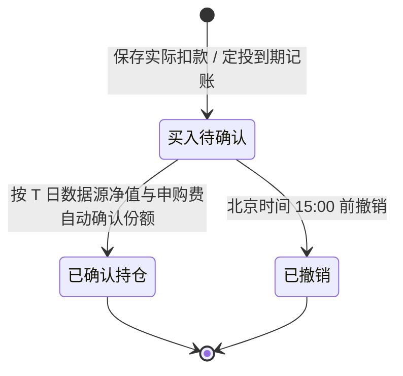

# LifeUp · 产品设计文档

**版本：V1.4（基于 V1.3）　｜　整理日期：2026-10-26　｜　更新日期：2026-11-19　｜　形态：手机端 Web App / PWA**

> 为保持仓库内历史文档链接稳定，文件名沿用 `LifeUp-产品设计文档-V1.1.md`，正文以当前最新版本号 **V1.4** 为准。

**文档状态：已确认页面形态与核心业务规则的唯一业务依据。V1.4 已按最新产品形态全面同步：五类资产（含股票）口径、4+1 悬浮双胶囊导航、首页 1+2+2 双列流光资产卡与全局金额脱敏、当日/本月变化明细口径、账单月度预算与默认收支日历、两级分类独立管理页与历史月度支出导入、基金与贵金属实装口径、工资档案迁入「我的」及年终奖建模、认证移除与备份版本 V5。**

本产品服务于个人资产观察和日常记账：用一个统一现金池承接生活收支，把跨平台基金（含 QDII）、A 股与场内 ETF / LOF、公积金和贵金属（平台积存金）汇总到同一资产总览中，持续观察家底变化、交易在途与长期资本积累目标，减少重复维护。

实际功能迭代进度与验证记录见[功能迭代总览](../development/README.md)：持久化存储、真实行情接入、后台自动记账、资本目标推演、工资档案与导出备份已实现并有自动化覆盖；截图识别导入仍处于后续规划阶段，未纳入当前已发布流程。

### 修订记录

| 版本 | 日期 | 修订内容 |
| --- | --- | --- |
| V1.0 | 2026-10-20 | 首次整理：页面结构、术语口径、事件影响矩阵与验收场景 |
| V1.1 | 2026-10-26 | 同步首页“已记录资产”口径、趋势范围、本月变化分解、主导航结构与验收场景 |
| V1.1 修订 | 2026-10-27 | 同步五项底部导航、计划分组与整月交易日历、积存金自动报价与默认直接到账、公积金每月缴存并入表单、资产覆盖自动判定 |
| V1.2 补充 | 2026-10-30 | 新增 A 股与场内 ETF / LOF 股票模块，纳入总资产、趋势、变化、覆盖、行情与备份 |
| V1.3 | 2026-11-13 | 新增资本积累与目标（总资产目标、月度推演、玻璃轨道、自动里程碑）；底部「计划」改为「目标」，自动计划并入目标页 |
| V1.4 | 2026-11-19 | 全量同步最新产品形态：全篇统一五类资产口径并补齐第 20 章股票完整规则；底部导航更新为 4+1 悬浮双胶囊（「账单 / 总览 / 目标 / 我的」＋右侧独立「＋」）；首页更新为双列流光资产卡、全局脱敏眼睛、当日/本月变化明细拆解并移除首页自动计划卡；账单新增月度预算环、默认收支日历三视图、两级分类独立管理页与历史月度支出导入；基金/贵金属/现金/公积金对齐实装规则；工资档案迁入「我的」并联动资本预测年终奖与五类计划（备份 V5）；移除登录认证与未落地的截图导入首版页面 |

## 阅读与范围说明

- **已确认并落地的范围**：页面结构、统一现金池模式、两级用途分类记账、月度预算与收支日历、跨平台基金归集与分组、A 股与场内 ETF / LOF、公积金缴存与提取、贵金属（积存金）、五类自动记账计划、资本积累与目标、工资档案与年终奖、主题配色切换以及导出与完整备份恢复。
- **演示值说明**：文中 **12,000 元工资、5,200 元公积金缴存、2,000 元提取、30 克黄金及 2026 年 10 月日期均为说明口径的虚拟示例**，不视作真实资产数据或产品默认值。
- **数据边界**：正式产品支持建立账本后补录、查询和更正历史业务日期；尚未发生的周期事项使用自动计划或推演预览，不提前生成已发生流水。

## 目录

1. [目标、原则与产品范围](#1-目标原则与产品范围)
2. [信息架构与页面清单](#2-信息架构与页面清单)
3. [统一术语与统计规则](#3-统一术语与统计规则)
4. [首页：资产总览](#4-首页资产总览)
5. [账单：日历、明细、图表、预算与记一笔](#5-账单日历明细图表预算与记一笔)
6. [投资：组合、持仓与收益](#6-投资组合持仓与收益)
7. [投资录入、交易与定投](#7-投资录入交易与定投)
8. [现金](#8-现金)
9. [公积金](#9-公积金)
10. [贵金属（平台积存金）](#10-贵金属平台积存金)
11. [自动记账计划](#11-自动记账计划)
12. [初始化、核对与历史更正](#12-初始化核对与历史更正)
13. [数据对象与关联关系](#13-数据对象与关联关系)
14. [服务能力、数据保护与「我的」页](#14-服务能力数据保护与我的页)
15. [一致性示例](#15-一致性示例)
16. [验收场景](#16-验收场景)
17. [原型覆盖、实施选型与交付边界](#17-原型覆盖实施选型与交付边界)
18. [设计规范、原型与资料索引](#18-设计规范原型与资料索引)
19. [资本积累与目标](#19-资本积累与目标)
20. [A 股与场内 ETF / LOF](#20-a-股与场内-etf--lof)

## 1. 目标、原则与产品范围

### 1.1 核心目标

| 目标 | 用户应能完成的事情 |
|---|---|
| 看清家底 | 打开首页即可看到现金、基金、股票、公积金、贵金属五类资产合计、分布与走势 |
| 顺手记账 | 选择两级用途分类、输入金额和日期，即可记一笔并同步现金，结合月度预算与日历掌控花销 |
| 看清投资 | 跨平台归集场外/QDII 基金（同基金 A/C 类分列、同类别跨渠道汇总）与 A 股/场内 ETF 持仓 |
| 减少重复维护 | 通过工资档案与自动计划，按期自动记账工资、年终奖、公积金缴存/提取和基金定投 |
| 解释变化与长期规划 | 分清生活结余、公积金缴存、投资盈亏和核对差额；结合资产结构与假设推演长期资本积累目标 |

### 1.2 已确认的设计取舍

| 决策 | 采用的方案 | 原因与约束 |
|---|---|---|
| 整体模式 | 账单记账与五类资产总览联动 | 高频记账自然维护资产全貌 |
| 账单与记一笔 | 两级分类 + 四则数字键盘 + 月度预算 + 收支日历/列表/图表三视图 | 兼顾顺手录入、当月花销预警与按日/月/年复盘 |
| 基金投资 | 跨渠道按基金与份额类别归集、投资方向分组、1–3 项自选指标、自动确认份额 | 贴合多平台买基金后的统一复盘习惯 |
| 股票投资 | 沪/深/北 A 股与场内 ETF / LOF 统一管理，按成本均价核对 | 聚焦人民币场内现货，不引入复杂券商账户体系 |
| 现金账户 | 仅维护一个统一现金池 | 不要求每笔消费选择银行卡、微信或支付宝 |
| 平台信息 | 仅在基金原始持仓中保留 | 用于核对持仓来源，不扩展为多个生活现金账户 |
| 公积金 | 合并记录个人和单位缴存 | 同一余额，支持每月自动缴存与提取至现金 |
| 贵金属 | 平台积存金（按克数与元/克均价管理） | 自动获取上金所/工行参考报价，默认卖出直接到账 |
| 自动任务 | 服务端周期记账 + 外部定时唤醒 | 不依赖手机页面持续打开；仅做账面记录，不向平台下单 |
| 隐私与访问 | 单账本个人自用，默认开启全局金额脱敏 | 应用不内置登录认证；公网部署由反向代理或私有网络隔离 |

### 1.3 当前已覆盖范围

- **首页总览**：五类资产合计（未覆盖齐全称“已记录资产”，均录入或标记不持有后自动升级“总资产”）、全局金额脱敏、当日/本月变化及分项明细拆解、资产趋势图、本月收支比例条与 1+2+2 双列流光资产卡片。
- **账单与记一笔**：两级分类与独立分类管理页、四则运算数字键盘、历史修改与撤销、月度预算环、收支日历 / 账单列表 / 收支图表三视图、一级/二级分类排行、历史月度支出导入（不影响现金）。
- **基金投资**：场外与 QDII 基金多份额类别归集、投资分组、1–3 项自选指标、收益走势与日历、买入待确认（按 T 日净值折算与自动确认）、赎回申请/确认/到账、建账前已实现收益补录与中/美/港三地交易日定投。
- **股票投资**：沪/深/北 A 股与场内 ETF / LOF 多持仓录入、买卖、持仓核对、行情刷新与站点降级、资金流调整后的今日盈亏。
- **现金、公积金与贵金属**：统一现金池与余额核对、公积金缴存/提取与每月自动缴存设置、贵金属（积存金）自动三级参考报价与买卖直接到账。
- **目标与自动计划**：资本积累与总资产目标（玻璃轨道、自动里程碑、月度推演、年终奖与工资档案联动、本月实际对照）以及五类自动记账计划（工资、年终奖、公积金缴存、公积金提取、基金定投）与整月三地交易日历。
- **我的与数据主权**：个人头像昵称、工资档案（同步三项计划并驱动资本预测）、跟随系统 / 亮色 / 暗色三态主题配色、明细 CSV 导出与完整备份 JSON（版本 V5，兼容 V1–V5 校验恢复）。

### 1.4 明确不扩展与后续规划范围

- **不在产品范围内**：真实支付或券商/基金平台自动下单、银行自动扣款、多生活支付账户拆分、房产估值、房贷/车贷/负债、信用卡账单、家庭多人共享、手动资本记录、多目标并列、通胀调整、多情景对比、港美股/外币换汇、基金分红/拆分/转换独立流程、社交或投资建议。
- **后续规划（尚未实现）**：基金持仓截图识别草稿导入、自然语言/语音记账、真实 iPhone / PWA 安装与长短屏完整设备回归。

## 2. 信息架构与页面清单

底部采用 **4+1 悬浮双胶囊导航**：左侧胶囊依次为 **账单（`/ledger`）/ 总览（`/`）/ 目标（`/capital`、`/plans`）/ 我的（`/mine`、`/salary`）**，右侧为独立的薄荷绿圆形 **＋记一笔（`/entry`）** 主操作按钮。首页通过 1+2+2 资产卡片进入五类资产详情；「目标」通过顶部 `GoalTabs` 分段在「资本积累」与「自动计划」间切换。

```mermaid
flowchart TD
    Home["总览 /"] --> ChangeSheet["当日/本月变化明细弹层"]
    Home --> Assets["资产总览与不持有 /assets"]
    Home --> Cash["现金 /cash"]
    Home --> Funds["基金投资 /funds"]
    Home --> Stocks["A股与ETF /stocks"]
    Home --> PF["公积金 /provident"]
    Home --> Gold["贵金属 /gold"]

    Ledger["账单 /ledger"] --> Calendar["收支日历(默认)"]
    Ledger --> List["账单列表与预算环"]
    Ledger --> Charts["收支图表(一级/二级排行)"]
    Ledger --> Categories["分类管理 /categories"]

    Plus["右侧独立＋"] --> Entry["记一笔 /entry"]
    Entry --> Categories

    Goal["目标"] --> Capital["资本积累 /capital"]
    Goal --> Plans["自动计划 /plans"]

    Funds --> Holdings["持仓明细"]
    Funds --> Returns["收益日历与走势"]
    Funds --> Trades["交易记录"]
    Funds --> Recurring["我的定投"]

    Mine["我的 /mine"] --> Profile["头像与昵称"]
    Mine --> Salary["工资档案 /salary"]
    Mine --> Theme["主题配色(跟随系统/亮/暗)"]
    Mine --> Backup["数据导出与备份 /backup"]
```



| 编号 | 页面 / 模块 | 路由 | 核心入口 | 返回关系 |
|---|---|---|---|---|
| P01 | 首页资产总览 | `/` | 底部「总览」 | 一级页面 |
| P02 | 账单（日历 / 列表 / 图表 / 预算） | `/ledger` | 底部「账单」、首页本月收支 | 一级页面 |
| P03 | 分类管理（两级分类与拖拽排序） | `/categories` | 账单页 / 记一笔页右上角 | 返回来源页 |
| P04 | 记一笔 | `/entry` | 底部右侧独立「＋」、现金页、账单编辑 | 取消回来源页；完成返回并刷新 |
| P05 | 资产总览与维护 | `/assets` | 首页或管理入口 | 返回总览 |
| P06 | 现金 | `/cash` | 首页现金卡、资产页 | 返回总览 / 资产页 |
| P07 | 基金投资（持仓 / 收益 / 交易 / 定投） | `/funds/:view?` | 首页基金卡、资产页 | 返回总览 / 资产页 |
| P08 | 股票（A 股与场内 ETF / LOF） | `/stocks` | 首页股票卡、资产页 | 返回总览 / 资产页 |
| P09 | 公积金 | `/provident` | 首页公积金卡、资产页 | 返回总览 / 资产页 |
| P10 | 贵金属（平台积存金） | `/gold` | 首页贵金属卡、资产页 | 返回总览 / 资产页 |
| P11 | 资本积累与目标 | `/capital` | 底部「目标」默认分段 | 一级页面 |
| P12 | 自动记账计划与交易日历 | `/plans` | 「目标 → 自动计划」、工资档案页快捷入口 | 一级分段 |
| P13 | 我的 | `/mine` | 底部「我的」 | 一级页面 |
| P14 | 工资档案 | `/salary` | 我的 → 个人信息 | 返回「我的」 |
| P15 | 数据导出与备份恢复 | `/backup` | 我的 → 数据管理 | 返回「我的」 |
| P16 | 账本初始化 | `/setup` | 首次打开未初始化时自动进入 | 初始化后进入总览 |

## 3. 统一术语与统计规则

### 3.1 资产与收支的边界

“总资产”表示本版**五类资产**的合计。本版没有负债模块，不将其称为已经扣除全部负债的“净资产”。

```text
总资产 = 统一现金余额 + 基金资产 + 股票资产 + 公积金余额 + 贵金属资产

基金资产 = 已确认份额估值 + 买入待确认估值 + 赎回待到账资金
股票资产 = Σ(持仓股数 × 当前有效行情价)
贵金属资产 = 持有克数 × 有效参考报价 + 历史卖出待到账资金

日常结余 = 日常收入 − 消费支出
```

在途或待到账款项仍有明确归属，不因暂未确认或尚未收款而从总资产中消失。同一笔金额只能存在于一个资产状态中，不能同时计入现金与待确认、或持仓与待到账。

“已记录资产”与“总资产”是两个口径，不得混用：

| 口径 | 含义 | 使用条件 |
|---|---|---|
| 已记录资产 | 当前已录入并可计算的资产合计 | 五类资产中仍有类别既未录入也未标记“不持有”时使用 |
| 总资产 | 完整五类资产的合计 | 现金始终计入，其余四类（基金、股票、公积金、贵金属）均已录入或已标记“不持有”后自动升级 |

五类资产未全部覆盖之前，页面只显示“已记录资产”，不以缺失项按 0 冒充完整总资产。

### 3.2 事件影响矩阵

下表中的“总资产影响”不包含交易之后的新行情变化。

| 业务事件 | 现金 | 其他资产 | 生活收支 | 总资产影响 |
|---|---|---|---|---|
| 消费支出 X | −X | 无 | 支出＋X | −X |
| 历史月度支出导入 X（`MonthlyImport`） | 不变（0） | 无 | 支出＋X（仅账单/图表统计） | 0 |
| 工资 / 年终奖等日常收入 X | ＋X | 无 | 收入＋X | ＋X |
| 公积金缴存 X | 不变 | 公积金＋X | 不计入 | ＋X |
| 公积金提取 X | ＋X | 公积金−X | 不计入 | 0 |
| 基金买入扣款 X | −X | 买入待确认＋X（T 日起按净值折算） | 不计入 | 0（T 日起随净值变动） |
| 基金买入确认 | 不再扣款 | 待确认转为已确认份额估值 | 不计入 | 申购费与确认价差反映为投资变化 |
| 基金赎回确认 | 不变 | 减少份额，增加待到账 | 不计入 | 按净到账及费用反映差额 |
| 基金赎回到账 X | ＋X | 基金待到账−X | 不计入 | 0 |
| 股票买入 X | −X | 股票数量与成本增加 | 不计入 | 当前市值与成交额的价差 |
| 股票卖出 X | ＋X | 股票数量减少、按比例结转成本 | 不计入 | 卖出净额与估值的差额 |
| 贵金属买入 X | −X | 增加克数与成本 | 不计入 | 当前估值与实际扣款的差额 |
| 贵金属卖出 X（默认直接到账） | ＋X | 减少克数、按比例结转成本 | 不计入 | 卖出金额与估值的差额 |
| 历史贵金属待到账到账 X | ＋X | 贵金属待到账−X | 不计入 | 0 |
| 行情 / 净值 / 报价更新 | 不变 | 更新持仓估值 | 不计入 | 估值差额 |
| 起始资产录入 | 按起始值建立 | 按起始值建立 | 不计入 | 建立统计起点，不解释为收入或收益 |
| 余额 / 持仓核对更正 | 依更正对象 | 依更正对象 | 不自动计入 | 作为核对差额单列 |

### 3.3 日期、币种与精度

- 业务日期固定北京时间 `Asia/Shanghai`。保留业务发生日期以及创建、修改、确认、到账和行情更新时间，互不替代。
- 日、月、年统计按业务日期划分自然周期，不按创建时间划分。
- 金额展示两位小数，统一人民币（`CNY`），服务端以精确十进制计算，不使用二进制浮点累积。
- 基金份额与贵金属克数展示四位小数；股票单价/均价展示最多三位小数（服务端成本均价保留四位）；净值保留来源有效精度。
- 成本按加权平均比例结转，最后一笔清仓结转全部剩余成本；成本为 0 时收益率展示“—”。
- 金额、份额、股数、克数必须非负；新增交易必须大于 0；现金、公积金和可售持仓不得因记录变为负数。

### 3.4 首页变化构成

- **当日变化（默认视角）**：按北京时间比较昨日与今日估值，拆解为**现金收入、现金支出、公积金缴存、基金盈亏、股票盈亏、贵金属盈亏、现金核对差额、持仓核对差额及其他余额差额**。现金收支仅统计实际影响现金余额的账单（不含 `MonthlyImport`）。
- **投资盈亏算法**：`今日估值 − 昨日估值 + 该类资产对应现金变动 − 新增录入价值 − 持仓核对差额`。买卖本金、赎回到账与公积金提取在资产间抵消。点击「当日变化」打开弹层，按“资产增加 / 资产减少 / 持平或暂无数据”三组展示（全局脱敏开启时不分组），投资项可进一步展开查看各项计算明细。
- **基金净值日期兜底**：最新披露的基金净值早于当天时，总览当日合计叠加该净值日的基金收益，并标注「含 M月D日 净值收益」。变化比例以昨日可比资产为基数。
- **本月变化**：

```text
本月变化 = 今天已记录资产 − 月初已记录资产（同口径）
         = 本月市值变动 + 本月净存入 · 转账

本月新增记录单列，不计入变化
```

只累加月初与今天均已记录的类别，本月新录入类别单列标注“不计入变化”。现金和公积金称“余额变化”，基金、股票和贵金属的市值变化称“收益”。无月初可比基线时，展示“自起始记录以来变化”及起始日期。

### 3.5 一次业务、同步更新

保存一次业务后，现金、资产、明细与统计在服务端同一事务内生效；所有写请求携带 `requestId` 防重，关键余额与持仓核对携带 `version` 乐观并发校验。交易主记录是唯一事实来源，多个页面共享同一数据。

## 4. 首页：资产总览

### 4.1 页面布局与核心交互

按以下自上而下顺序呈现：

1. **顶部全宽彩色/深色 Hero**：
   - 顶栏：左侧大标题「总览」（不显示品牌名），右侧为数据更新日期与圆形「同步行情」按钮。
   - 资产总额：标签（未覆盖完整称「已记录资产」，覆盖完整称「总资产」）、主金额、`CNY` 标识与 **全局金额脱敏眼睛按钮（`AmountVisibilityButton`）**。脱敏状态默认开启，与资产页、目标页共享 `amountsMasked`，一键隐藏/显示金额、占比、收支拔河条、卡片流光与趋势点读数。
   - 变化区：当日/本月变化胶囊（点击打开变化构成 BottomSheet）+ 右侧「当日 / 本月」切换胶囊（默认「当日」，同时切换现金、基金、股票和贵金属卡片的对比周期）。
   - 趋势图：无坐标轴薄荷绿趋势曲线 + 底部范围切换轨道（`7日 / 1月 / 3月 / 全部`，默认 `7日`）。
2. **本月收支卡**（Hero 下方首位）：上方双列展示本月收入与本月支出（带语义色点），中间为 16px 双色比例拔河条（单边达 4 倍及以上时弱势段缩为 6px 锚点，双零为空轨道），底部展示本月结余；点击可进入账单页。
3. **资产分布卡片（1+2+2 双列流光网格）**：按 **现金、基金、股票、公积金、贵金属** 顺序排布，现金横跨两列，其余四类呈 2×2 网格。卡片显示余额、资产占比、按占比定位的流光，以及「详情 / 录入」入口。现金、基金、股票和贵金属分两行显示带正负号的余额变化额和比例，分别以昨日或上月末余额为基数。基数为零或缺失时，比例显示「—」。公积金分两行显示本月「缴存」与「提取」，金额四舍五入到元。

> 首页不再放置自动记账卡片；所有自动计划统一收口到「目标 → 自动计划」。

### 4.2 资产覆盖与资产总览页（`/assets`）

- 五类资产中，现金始终计入；基金、股票、公积金和贵金属可在资产页或各模块空状态标记为“不持有”。
- 五类资产全部已录入或已标记“不持有”时，首页与资产页自动升级为「总资产」，无需额外确认步骤；有持仓的资产不允许标记“不持有”，取消标记后恢复待录入。
- 资产总览页保留分段比例条与列表视图，右上角提供「维护」弹层，支持直达现金核对（`/cash?action=reconcile`）及各类资产录入、查看与恢复。

### 4.3 资产趋势规则

- 支持 `7日 / 1月 / 3月 / 全部`，记录不足 7 天时显示紧凑进度状态，不绘制曲线。
- 只累计区间起点已记录的类别；新增录入类别在当天用虚线标记，不计入曲线增幅。
- 触摸或点击日期点在图表上方叠放读数；不填 0 伪造建账前走势；晚披露净值保留净值日期与取得时间。

## 5. 账单：日历、明细、图表、预算与记一笔

### 5.1 账单页（`/ledger`）

- **顶栏**：周期选择与前后切换（当年月份简写如 `11月`），右上角为 **分类设置入口（`/categories`）**。
- **本月支出与月度预算卡**：白色卡片聚焦展示当前周期支出总额（月视图为本月支出、日/年视图为当天/本年支出）。月视图内嵌 **月度预算模块（`LedgerMonthlyBudget`）**，通过环形进度环展示已用比例、剩余/超出金额与当月每日可花；点击可弹出 BottomSheet 设置、修改或取消当月预算。
- **三视图切换**：
  1. **收支日历（默认视图）**：整月日历格展示每日收支净额与主分类图标，点选日期在下方联动展示当日流水。
  2. **账单列表**：支持日/月/年周期切换，按日期倒序分组展示日常收支，提供折叠式「搜索与筛选」（按收支方向、分类或关键字过滤）；点击任意流水进入编辑或撤销。
  3. **收支图表**：支持支出/收入方向切换、日/月/年周期切换与 **「一级分类 / 二级分类」汇总层级切换**；展示周期总额、日均消费、趋势图及分类排行（二级分类排行支持点击反查对应流水）。
- 公积金缴存/提取及投资买卖不混入生活账单明细。

### 5.2 两级分类与独立分类管理（`/categories`）

- 分类模型升级为 **一级分组 → 二级分类**，并支持自定义图标（自动映射 5 色语义微彩）：
  - 默认支出一级分组：**固定 / 必要 / 弹性 / 其他**；
  - 默认收入一级分组：**经常收入 / 其他收入**。
- 分类维护统一收口到独立的 **`/categories` 分类管理页**（从账单页或记一笔页右上角进入），支持支出/收入切换、新建与编辑一级/二级分类、更换图标、启停、折叠展开，以及 **长按拖拽排序 / 跨一级分组移动**（同时提供点击句柄的上移/下移/跨组菜单）。
- 已有历史流水引用的分类改名会同步更新展示名称，停用或删除不影响历史记录展示与统计。当账本启用一级分组时，记一笔页内不再触发长按拖拽编辑，统一跳转 `/categories`。

### 5.3 记一笔（`/entry`）

主要路径：**选择支出 / 收入 → 选择二级用途分类 → 输入金额 → 保存后再记 / 完成**。

| 字段 / 控件 | 规则 |
|---|---|
| 收支方向 | 默认支出；现金页「记收入」进入时默认收入 |
| 分类网格 | 按一级分组呈现二级分类，不选择支付平台；右上角直达分类管理 |
| 金额与键盘 | 必填，大于 0、精确到分；内置数字键盘支持 `＋ / − / × / ÷` 四则运算、`00` 与 `＝`，保存计算结果 |
| 日期与备注 | 默认今天，可补记过去日期；未来周期使用自动计划；备注选填 |
| 提交与退出 | 新增底部提供「保存后再记」与「完成」双操作；未保存离开有二次确认；编辑态的撤销操作收在右上角「更多」 |

保存支出扣减现金、保存收入增加现金；现金不足时阻止保存并提示核对余额。

### 5.4 历史月度支出导入（不影响现金）

- 支持通过导入接口批量补录建账前的历史月度支出汇总（`LedgerEntrySource.MonthlyImport`，限定早于 `2026-11-01` 的月初日期，支持幂等防重）。
- `MonthlyImport` 记录的 **`CashEffect = 0`**，只参与账单列表、图表统计与资本目标月支出均值估算，**不改变现金余额与资产变化口径**。

### 5.5 日均统计口径

当前月/年按该周期 1 日起至今天的天数计算；完整历史月/年按自然周期总天数计算；日视图分母为 1；不计入未来日期。

## 6. 投资：组合、持仓与收益

### 6.1 投资总览（`/funds/:view?`）

- 顶部 Hero 展示基金总资产（含已确认估值、买入待确认估值与赎回待到账）、今日收益、持有收益（含持有收益率）、已实现收益及右上角更新进度环 `UpdateRing`。
- 中部为横向 **投资分组胶囊**（全部基金 + 自定义分组 +「管理」入口弹层），切换分组后顶部统计、持仓、收益、交易和定投同步按同一范围汇总。
- 下方包含四个视图标签：**持仓明细 / 收益日历 / 交易记录 / 我的定投**。

### 6.2 基金、份额类别与跨渠道聚合

存储层次为 **投资分组 → 基金汇总实体 → 份额类别 → 原始平台持仓**：

- 同名基金的 A/C 等份额类别分别保留独立代码、份额、成本与净值，展示在同一基金下但**不混加份额、不平均净值**。
- 同代码同类别持仓跨购买渠道汇总金额、份额、成本与盈亏，持仓列表不再按渠道拆行；原始平台记录保留在明细中用于核对与追溯（单平台持仓不重复显示份额）。
- 调整分组按基金实体移动全部类别，不生成交易流水；删除分组后基金回归「未分组」。

### 6.3 持仓列表与卡片口径

- 列表固定按含在途资产价值（`assetValue`）降序排列，卡片主数字采用 **含待确认与待到账的资产口径**（并在占比旁标注「含待确认」），保证所有基金卡片金额之和等于顶部总资产。
- 搜索与指标配置收在右上角筛选弹层中；用户可自选 **1–3 项**展示指标（默认 **日收益 / 累计收益 / 累计收益率**，可选持仓价值、持仓成本、占比、待确认金额等）。
- 基金展开区提供 **买入 / 卖出 / 调整份额** 快捷操作（不提供单持仓手工刷新净值入口，净值统一由数据源批量或定时刷新）。

### 6.4 估值、成本与收益口径

```text
类别已确认估值 = 已确认份额 × 有效净值
买入待确认估值 = 扣款金额 ÷ T日净值 × 当日净值（T日净值未披露时暂按承诺扣款金额）
基金总资产 = 已确认估值 + 买入待确认估值 + 赎回待到账

持有收益 = 已确认估值 − 剩余持仓成本
已实现收益 = 账本内卖出/分红已实现收益 + 建账前已实现收益（持仓录入时补录，重放不覆盖）
累计收益 = 持有收益 + 已实现收益
```

待确认资金计入总资产并从 T 日起参与收益估算，但不计入已确认持仓收益率分母。

### 6.5 收益走势、日历与进度环

- 提供 **本月 / 近 3 月 / 今年 / 全部** 收益走势与按日收益日历；严格按实际净值披露日归属收益，未披露日显示“—”不填 0。
- 顶部「今日收益」与收益日历采用同一净值日算法，仅累加该日已披露基金并提示「仅 X/Y 只基金披露」；左侧 `UpdateRing` 显示披露进度与刷新态，仅在**全部持仓披露完成且无行情错误**时按当日收益正负展示笑脸/哭脸表情。
- 区间盈亏按期末值减期初值扣除资金净转入与核对差额计算，与持有收益分列命名。

### 6.6 特殊事项边界

首版不含基金分红、份额拆分、基金转换独立录入页；遇特殊事项可通过份额核对与原因备注处理，核对差额不自动归为投资收益。

## 7. 投资录入、交易与定投

### 7.1 录入类型区分

| 录入类型 | 用途 | 是否扣现金 |
|---|---|---|
| 已有持仓录入 | 初始化或补录已有基金持仓（可同时填写「建账前已实现收益」） | 否 |
| 新买入记录 | 记录实际购买扣款，进入买入待确认 | 是，且仅扣一次 |
| 赎回 / 到账记录 | 申请冻结份额 → 确认转待到账 → 到账转入现金 | 到账时增加现金 |
| 定投计划 | 保存未来周期规则（未持有可直接搜索建 0 份额持仓） | 保存本身不扣款 |

已有持仓录入通过基金搜索自动识别份额类别、QDII 属性与确认周期，平台使用固定下拉（券商直销 / 支付宝 / 天天基金 / 银行）；同基金同类别同平台已有记录时提示选择「更新已有持仓」或「新增独立持仓」。

> **关于截图识别导入**：截图识别草稿核对流程保留为后续规划方向，当前版本未提供前端入口与识别服务，持仓均通过搜索与手动录入完成。

### 7.2 买入待确认与自动确认份额



- 前端买入表单精简为 **基金持仓、扣款金额、实际申购费、备注**，下单日期默认为当天；北京时间 15:00 前下单以当日为 T 日，15:00 起顺延至下一开放交易日，15:00 前可在待确认详情弹层内撤销。
- 持仓默认 T+2 自动确认（可按基金设为 T+1），行情刷新（含启动刷新）取得 T 日净值后按 `(扣款金额 − 申购费) ÷ T 日净值`（四位小数向下取整）自动确认结转，前端不再保留手动输入确认份额入口（后端接口保留运维/兼容能力）。
- 交易记录列表自动折叠已完成前置环节的下单/申请条目，**未确认与进行中单据置顶**，支持状态（全部/进行中/已完成）与类型筛选。

### 7.3 赎回与到账

- **赎回申请**：冻结对应份额，防超卖，不改变现金与成本，支持试算预计净到账。
- **赎回确认**：扣减份额与加权平均成本，净到账金额转入「赎回待到账」。
- **赎回到账**：等额从待到账转入现金，不重复计收益，不计入生活收入。

### 7.4 定投计划与三地交易日

- 支持每周、每月和交易日（中国交易日 / 中美港三地交易日，按 QDII 属性自动默认）周期及每期申购费设置。
- 交易日定投在 15:00 前创建且当日开市则从当天开始，否则顺延至下一合格交易日；**延迟补跑定投时仍按原计划下单时间判定 T 日**，不因补跑越过 15:00 而误推后一天。
- 到期自动扣减账本现金并生成买入待确认，现金不足时整笔待处理；不向基金平台实际下单。详见[基金交易日历与持仓聚合设计规格](../design/基金交易日历与持仓聚合-设计规格-2026-10-26.md)。

## 8. 现金

### 8.1 页面结构（`/cash`）

- 顶部 Hero 展示统一可用余额与「核对余额」入口；下方展示 **本月现金流入 / 本月现金流出 / 余额净变动** 以及「记支出 / 记收入」快捷操作。
- 现金变动列表按日分组，支持 **全部 / 日常收支 / 资产流转 / 余额调整** 四态筛选（不再在现金页底部堆叠关联计划列表，计划统一在「目标 → 自动计划」管理）。

### 8.2 现金流与余额核对

```text
余额净变动 = 当前现金 − 周期起始现金
           = 现金流入 − 现金流出 + 单列余额核对差额
```

核对余额填写实际余额与原因，与账面一致时不生成 0 元记录；存在差额时生成独立调整记录，不污染日常收入或消费。后续漏记业务补录时可通过关联原核对记录替换差额，避免重复扣减。

## 9. 公积金

### 9.1 页面结构与操作（`/provident`）

- 顶部 Hero 展示公积金余额，下方展示本月缴存、本月提取与余额净变动，提供 **录入余额 / 缴存·提取** 入口。
- 录入余额、日常缴存与提取默认按当天业务日期入账（表单精简，不提供日期选择框）；缴存与提取可在同一弹层内单项或同时登记。
- **每月自动缴存**并入缴存/提取表单：勾选后可直接新建、更新、暂停或恢复每月自动缴存计划；每月提取仍在「目标 → 自动计划」中独立管理。

### 9.2 缴存、提取与核对规则

- **缴存**：个人与单位合计记为一笔，公积金增加，不改变现金、不计入生活收入、计入总资产增加。
- **提取**：提取金额不得超过余额，保存后公积金减少且现金等额增加，不计入生活收入、不改变总资产；提取金额大于 0 时支持关联已有现金核对差额。
- **核对**：余额核对只记录差额，不自动联动现金。

## 10. 贵金属（平台积存金）

### 10.1 页面结构与指标（`/gold`）

- 首页与资产页统一称「贵金属」，详情页按克数管理平台积存金。
- 顶部 Hero 展示贵金属总资产，核心指标为 **总收益（持有收益 + 已实现收益）/ 总收益率 / 成本均价（元/克）**，并明确展示当前参考报价单价、日期与**具体行情来源名称**（如 `Au99.99 现货参考价` / `上金所延时参考价` / `工行积存金报价`）。
- 操作区提供 **买入 / 卖出 / 核对持仓 / 刷新报价**；空状态支持直接标记「没有贵金属，标记为不持有」。

### 10.2 买卖与成本规则

- **录入 / 核对持仓**：填写持有克数与成本均价（元/克），保存时按 `克数 × 均价` 折算总成本，再次核对还原回填避免舍入漂移。
- **买入**：填写克数、实际扣款金额与日期，扣减现金并增加克数与成本；自动采用当前有效参考报价。
- **卖出**：默认直接到账并等额增加现金，按加权平均成本结转并核算已实现收益；**详情弹层与已清仓区均展示「已实现收益」**；后端保留历史待到账数据兼容。

### 10.3 自动三级参考报价

- 进入页面自动刷新，同时支持点击「刷新报价」手动触发，不提供手动输入报价入口。
- 服务端按三级降级获取报价：**东方财富上金所 Au99.99 现货 → 上金所官方延时行情 → 工行积存金参考价**；刷新失败时保留最近有效值与日期并提示失败原因。

## 11. 自动记账计划

### 11.1 页面布局与五类计划（`/plans`）

作为「目标」页的「自动计划」分段，页面自上而下依次为：

1. 顶部 `GoalTabs` 分段（`资本积累 / 自动计划`）与页头「自动记账」＋「立即执行」按钮。
2. **计划三分组（默认折叠）**：**基金定投 / 公积金 / 工资收入**，各分组右侧提供「＋ 新增」入口；同基金不同份额类别合并为一张基金卡展示，执行时按类别独立扣款；由工资档案托管的计划显示「工资档案」标签，金额只读并引导至「我的 → 个人信息」修改。
3. **待处理期次区**（有待处理/失败期次时出现）：提供补记、重试或跳过。
4. **整月交易日历（`PlanCalendar`）**：按中国日期展示整月，标注顺延三地交易日定投的香港或美国休市日。
5. **执行记录（默认折叠）**：每页 10 条分页展示。

| 类型 | 周期与配置 | 到期记账结果 |
|---|---|---|
| 工资到账 | 每月日期、到手金额、时间（可由工资档案托管） | 现金增加，记入工资收入分类 |
| 年终奖到账 | 年度发放月、发薪日、到手金额（由工资档案托管） | 现金增加，记入奖金收入分类 |
| 公积金缴存 | 每月日期、个人+单位合计（可由工资档案托管） | 公积金增加 |
| 公积金提取 | 每月日期、提取额度 | 公积金减少，现金等额增加 |
| 基金定投 | 每周 / 每月 / 中国或三地交易日、每期金额与申购费 | 现金减少，买入待确认增加 |

### 11.2 排序、删除、重试与机器唤醒

- **同日执行顺序**：`工资 → 年终奖 → 公积金缴存 → 公积金提取 → 基金定投`。月末 31 日遇小月自动落到当月最后一天。
- **修改、暂停与删除**：编辑或暂停只影响未来期次；非工资档案托管的计划支持**删除**（二次确认，保留历史已记流水）。
- **期次唯一与自动重试**：每个「计划 + 周期」生成唯一执行期次，绝不重复扣款。到期当天遇技术失败或版本冲突时后台**自动重试（最多 3 次）**；跨天失败或余额不足保持待处理状态，由用户手动补记或跳过，不静默追扣。
- **外部定时唤醒**：除服务内定时调度外，支持外部定时任务通过共享令牌调用 `POST /api/cron/plans/run` 唤醒云端实例执行到期计划。

## 12. 初始化、核对与历史更正

### 12.1 初始化顺序（`/setup`）

1. 设置账本起始业务日期、起始现金余额与人民币口径。
2. 按需录入已有基金、股票、公积金、贵金属持仓，或将未持有的类别标记为「不持有」；五类全部覆盖后首页自动升级显示「总资产」。
3. 在「我的 → 个人信息」维护工资档案，或在「目标 → 自动计划」配置定投与其他周期计划。

建立起始资产不扣减现金，也不伪造建账前的收入或投资收益。

### 12.2 历史更正与核对防重

- 修改普通收支按差额联动现金；撤销业务恢复账面影响并保留原始记录与审计痕迹。
- 修改历史业务后按业务日期重算后续余额、成本与趋势；会导致历史负余额或超卖的修改将被拒绝。
- 漏记业务补录可关联此前现金核对记录以替换差额，避免同一笔遗漏既记为消费又保留核对差额。

## 13. 数据对象与关联关系

| 对象 | 关键内容 | 关联与约束 |
|---|---|---|
| 个人账本 | 币种（CNY）、时区、起始日期、五类资产覆盖状态、版本号 | 单账本事实根 |
| 两级收支分类 | 方向、父级分组、名称、图标键、排序、启停状态 | 历史流水引用永久保留 |
| 日常收支记录 | 方向、分类、业务日期、金额、来源（手动 / 自动 / 月度导入）、备注、状态 | `MonthlyImport` 的 `CashEffect = 0` |
| 月度预算 | 年月、预算金额 | 仅用于账单消费进度预警，不影响资产 |
| 起始与核对记录 | 资产对象、日期、原值、新值、差额、原因 | 与生活收支和市场收益隔离 |
| 基金汇总 / 类别 / 平台持仓 | 基金实体、A/C 代码、平台、份额、成本、建账前已实现收益、分组 | 同基金类别不混加份额，同类别跨渠道汇总 |
| 基金交易 | 买入/赎回、下单/T日/确认/到账日期、金额、份额、净值、费用、状态 | 关联现金与在途，自动按 T 日净值确认 |
| 股票持仓与交易 | 市场（沪/深/北）、代码、名称、股数、成本均价、买卖与核对记录 | 纳入总资产、今日盈亏与历史重放 |
| 贵金属持仓与交易 | 克数、成本均价、总成本、已实现收益、买卖与核对记录 | 卖出默认直接到账，兼容历史待到账 |
| 行情观测记录 | 标的、有效日期、净值/现价/昨收/金价、来源标识、取得时间 | 保留有效日期与来源，失败不写 0 |
| 自动计划与期次 | 五类计划配置、托管来源、唯一周期期次、重试次数、执行状态与关联流水 | 同一周期去重，重试不重复落账 |
| 工资档案 | 税前 Base、税后月薪、公积金双边合计、年终奖月数/到手/发放月、发薪日 | 同步三项计划并为资本预测提供默认输入 |
| 资本目标与假设 | 目标金额、跟随档案标志、收支/公积金/年终奖假设、增长率与年化假设 | 投影、年度表与里程碑实时派生，不单独落流水 |

## 14. 服务能力、数据保护与「我的」页

### 14.1 正式服务能力

前端手机端 Web App / PWA 与后端分层单体 API + PostgreSQL 协同工作，提供事务性记账与重放、多源行情定时刷新与站点降级、后台计划调度与外部 Cron 唤醒、资本推演计算以及明细导出与完整备份恢复。

### 14.2 「我的」页结构（`/mine`）

「我的」页精简为三个清晰分区：

1. **个人信息**：
   - **头像与昵称**：本机存储，支持上传压缩自定义头像或切换默认头像（默认昵称 `LifeUp`）。
   - **工资档案（`/salary`）**：集中维护税前 Base、每月税后工资、公积金双边月缴存、年终奖月数、年终奖到手、发放月与发薪日。详情页默认脱敏展示税后与积累口径（税后月薪、公积金、年终奖到手、年度到手现金、公积金年积累；税前 Base 与税前年包仅在编辑弹层预览）。保存时自动同步工资、公积金缴存与年终奖三项计划，并作为资本积累预测的默认数据源；支持停用档案（保留现有计划）。
2. **个性化设置**：
   - **主题配色**：提供「跟随系统 / 亮色（Daylight Prism）/ 暗色（Obsidian Mint）」三态切换，实时同步页面主题、ECharts 图表配色与状态栏 `theme-color`。
3. **数据管理**：
   - **数据导出与备份（`/backup`）**：支持导出可对账明细 CSV 与下载完整备份 JSON（**备份版本 V5**，包含五类资产、分类、收支、交易、行情、计划期次、资本目标与工资档案，兼容恢复 V1–V5）。恢复前必须经服务端完整性校验与历史重放核对并签发确认令牌，事务内全量替换，失败自动回滚且保留计划去重记录。

> 自动记账入口已移至「目标 → 自动计划」，分类管理已移至账单/记一笔右上角，行情同步直接在首页右上角完成。

### 14.3 访问控制与隐私边界

- 当前版本定位为个人自用单账本，**已移除内置登录、注册、会话 Cookie 与 Passkey 认证**，打开页面即进入账本；若部署至公网环境，需在反向代理、云平台访问策略或私有网络层自行配置访问保护。
- 外部定时唤醒接口 `/api/cron/plans/run` 通过独立 `X-Cron-Token` 鉴权。
- 敏感财务数字在首页、资产页、目标页与工资档案页均默认脱敏，保护日常公共场合看账隐私。

## 15. 一致性示例

以下为说明口径的虚拟数据示例（含五类资产）。

### 15.1 首页与本月变化

| 资产 | 10月1日起始 | 10月20日当前 | 变化解释 |
|---|---:|---:|---|
| 现金 | 25,200.00 | 23,400.00 | ＋12,000工资＋2,000提取−6,800消费−9,000基金买入 |
| 基金 | 157,800.00 | 168,000.00 | ＋9,000投入＋1,200区间盈亏；当前含300待确认 |
| 股票 | 50,000.00 | 51,500.00 | 沪深股票与 ETF 本月市值变化＋1,500 |
| 公积金 | 64,800.00 | 68,000.00 | ＋5,200缴存−2,000提取 |
| 贵金属 | 26,800.00 | 27,000.00 | 积存金本月估值变化＋200 |
| **总资产** | **324,600.00** | **337,900.00** | **＋13,300.00** |

变化构成（同口径）：净存入·转账 `10,400`（生活结余 5,200 ＋ 公积金缴存 5,200）＋ 市值变动 `2,900`（基金 1,200 ＋ 股票 1,500 ＋ 贵金属 200）＝ 本月变化 `13,300`。公积金提取 2,000 与基金买入 9,000 属于资产内部转移，净影响为 0。

### 15.2 典型联动

| 操作 | 结果 |
|---|---|
| 提取公积金 2,000 | 现金＋2,000，公积金−2,000，总资产与生活收入不变 |
| 买入基金 300 待确认 | 现金−300，基金待确认＋300，总资产不变，消费支出不增加 |
| 买入股票 5,000（按现价） | 现金−5,000，股票市值与成本＋5,000，总资产不变 |
| 现金核对＋100，再记消费 1 | 现金净增 99；核对差额＋100单列，消费支出＋1 |
| 导入历史月度支出 4,200 | 账单历史月支出＋4,200，现金余额与总资产保持不变 |

### 15.3 贵金属买卖完整路径

从现金 23,400、贵金属 30 克、成本 25,600、报价 900、估值 27,000 开始：

1. 买入 1 克，实际扣款 900：现金 22,500，31 克，成本 26,500，估值 27,900，总资产不变。
2. 卖出 1 克，报价 898（默认直接到账）：剩余 30 克，结转成本 854.84，剩余成本 25,645.16，现金 23,398，估值 27,000；本次已实现收益 `+43.16` 计入贵金属总收益并在详情区展示。

## 16. 验收场景

| 编号 | 场景 | 验收结果 |
|---|---|---|
| AC01 | 从首页 1+2+2 双列卡片进入五类资产并返回 | 余额与总览一致，默认脱敏与切换正常，返回路径清楚 |
| AC02 | 记 35.60 元餐饮（日期选上月）与四则键盘 `21×2+14` | 精确入账对应周期并扣减现金；四则表达式计算保存正确结果 |
| AC03 | 账单月度预算与三视图（日历/列表/图表） | 设置预算后实时更新进度环与日均可花；日历点选联动流水；支持一/二级分类汇总切换 |
| AC04 | 独立分类管理页新增/拖拽排序/跨组移动 | 改名同步历史，停用不影响旧统计，拖拽顺序持久生效 |
| AC05 | 导入历史月度支出（`MonthlyImport`） | 账单与图表计入该月支出，现金余额与资产趋势完全不变 |
| AC06 | 同基金 A/C 跨多平台与投资分组 | 类别份额与净值不混加，同类别跨渠道汇总，卡片含待确认之和等于顶部总资产 |
| AC07 | 基金买入待确认、15:00 前撤销与自动确认份额 | 扣款只扣一次，T 日起按净值折算，行情刷新后自动按 T 日净值结转份额 |
| AC08 | 基金赎回申请、确认、到账 | 申请冻结防超卖，确认转待到账，到账等额转现金不记生活收入 |
| AC09 | A 股 / ETF 买入、卖出、按均价核对与今日盈亏 | 现金联动准确，行情主备切换可用，非交易日显示最近交易日盈亏 |
| AC10 | 公积金缴存、提取与每月自动缴存 | 缴存增总资产不改现金，提取等额联动现金，支持关联现金核对差额 |
| AC11 | 贵金属自动三级报价、手动刷新与卖出直接到账 | 显示来源名称，买入扣现、卖出直接到账并累计已实现收益 |
| AC12 | 五类自动计划、三地交易日历与当天重试 | 按「工资→年终奖→缴存→提取→定投」执行，周期去重，当天技术失败最多自动重试 3 次 |
| AC13 | 工资档案保存同步与资本目标推演 | 保存档案同步三项计划并驱动资本预测（含年终奖发放月），切换手动覆盖不丢草稿 |
| AC14 | 主题三态切换与 iOS 安全区适配 | 跟随系统/亮色/暗色实时切换页面与图表配色，顶部安全区无状态栏雾化 |
| AC15 | 备份 V5 导出、校验与事务恢复 | 涵盖五类资产、工资档案与资本目标，恢复后计划已执行期次不重复记账 |
| AC16 | 首页自动覆盖与当日/本月变化拆解 | 五类资产全部录入或标不持有后自动升级「总资产」；当日变化明细投资项可展开核对 |

## 17. 原型覆盖、实施选型与交付边界

### 17.1 静态原型与正式产品对照

- **高保真交互原型（`prototype/`）**：已升级至 Midnight Mint v2.1 双主题（支持深浅色切换与金额脱敏），覆盖总览（1+2+2 双列流光卡、当日/本月变化弹层）、账单（月度预算环与日历/列表/图表）、记一笔、目标（资本积累玻璃轨道 + 自动计划与交易日历）、五类资产详情（含股票）与我的页（工资档案 + 主题切换），用于静态交互演示与视觉校准，刷新后数据重置。
- **正式产品（`web/` + `api/`）**：承载真实持久化、历史重放、外部多源行情、后台定时任务、外部 Cron 唤醒与事务备份恢复。

### 17.2 实施选型与现状

| 项目 | 产品约束 | 当前落地状态 |
|---|---|---|
| 应用与存储 | 手机 Web / PWA、云端正式账本、事务一致 | Vue 3 + TypeScript + ASP.NET Core 10 + PostgreSQL；Render 同源托管 |
| 基金行情 | 按独立份额类别与有效日期，不提供手工覆盖 | 天天基金主备数据源定时刷新与首页手动同步 |
| 股票行情 | A 股与场内 ETF / LOF 现价与昨收 | 东方财富主备站点公开行情，失败保留最近有效值 |
| 贵金属报价 | 自动获取并展示来源，不提供手工报价 | 上金所 Au99.99 现货 → 上金所延时 → 工行积存金三级降级 |
| 访问模式 | 个人单账本自用 | 无内置登录认证；公网访问由部署层隔离；Cron 接口由令牌校验 |
| 备份恢复 | 完整关联与计划去重，事务替换 | 明细 CSV + 完整备份 JSON V5（兼容 V1–V5） |
| 待后续规划 | 截图导入、真机 PWA 回归 | 截图识别未开发；真机 iPhone PWA 安装与长短屏待验收 |

## 18. 设计规范、原型与资料索引

- **UI 视觉与基础规范**：[Midnight Mint v2.1 视觉规范](../design/MidnightMint设计规范-2026-11-04.md)、[CSS 色彩变量](../design/ui-color-tokens.css)、[UI 基础规范](../design/UI基础规范-2026-10-28.md)、[UI 设计资料索引](../design/README.md)。
- **功能专题设计规格**：[基金交易日历与持仓聚合](../design/基金交易日历与持仓聚合-设计规格-2026-10-26.md)、[股票模块](../design/股票模块-设计规格-2026-10-30.md)、[资本积累与目标](../design/资本积累与目标-设计规格-2026-11-12.md)、[工资收入与年终奖](../design/工资收入与年终奖-设计规格-2026-11-13.md)。
- **交互原型**：在仓库根目录运行 `python3 -m http.server 4173 --bind 127.0.0.1` 后访问 `/prototype/` 查看现行 Midnight Mint v2.1 高保真交互原型（见[原型说明](../../prototype/README.md)）；早期 V1.0 评审线框归档于 [wireframes/index.html](../design/wireframes/index.html)。
- **前期研究**：[轻松算身家与持仓手记：资产管理产品对比调研（2026-10-19）](../research/资产管理APP对比调研-2026-10-19.md)。

## 19. 资本积累与目标

### 19.1 目标与口径

- 目标按 **五类总资产** 口径：现有现金、基金、股票、公积金和贵金属均计入进度，未来净积累与投资收益共同推动达标。
- 五类资产未全部录入且未全部标记“不持有”时，页面使用「已记录资产」并提示可能偏低。
- `资本积累 = 净积累 + 投资收益`，`净积累 = 生活结余 + 公积金缴存`；资产内部转移不计入积累。

### 19.2 月度假设、工资档案联动与年终奖推演

- **输入假设**：目标金额（按万元填写）、月收入（税后现金）、月支出、公积金月缴存、**年终奖（到手）与发放月**、收入年增长、支出年增长、投资年化（支持一键填入纳指 100 / 标普 500 20 年历史参考年化）、公积金年化（默认 1.5%）。
- **工资档案联动**：假设弹层支持 **「跟随工资档案 / 手动覆盖」** 切换；跟随时自动带入档案的月收入、公积金月缴存、年终奖与发放月并标注「工资档案」只读态；切换为手动覆盖时以当前生效值预填，保留用户手动草稿。
- **分桶与复利**：现金 0%，基金/股票/贵金属合并为投资桶按投资年化复利，公积金单独复利；预测自下月开始，年终奖在每年发放月计入现金流并随收入年增长放大；负结余先扣非公积金桶再扣公积金，耗尽后停止推演。

### 19.3 页面与交互（`/capital`）

- 顶部「目标」栏右侧为假设设置按钮，下方为 `GoalTabs`（`资本积累 / 自动计划`）。
- Hero 内置全局金额脱敏眼睛按钮，展示当前资本、距目标差额、月均积累（月度口径不摊平年终奖）、组合年化、**玻璃轨道（`GlassTrack`）**与预计达成年月；未设目标时展示带薄荷绿脉冲点的紫色引导卡。
- 玻璃轨道以资本进度为横轴，按目标每 10% 自动生成历史里程碑四角星；下方依次为积累曲线卡（资本曲线 / 每月积累）、年度积累表（表尾注明「净储蓄含年终奖」）与本月实际卡（发放月预期加计年终奖）。
- 假设表单采用 iOS Inset Grouped 单列堆叠布局，支持「用计划收入 / 用账单预设 / 用缴存设置」快速填充与实时预览。

### 19.4 数据与备份

接口为 `GET /api/ledger/capital`、`PUT /api/ledger/capital` 与 `POST /api/ledger/capital/preview`；配置随账本写入 **备份版本 V5**（兼容 V1–V5）。详细规格见[资本积累与目标设计规格](../design/资本积累与目标-设计规格-2026-11-12.md)与[工资收入与年终奖设计规格](../design/工资收入与年终奖-设计规格-2026-11-13.md)。

## 20. A 股与场内 ETF / LOF

### 20.1 适用范围与定位

- 覆盖人民币计价的 **沪市、深市、北交所 A 股** 以及 **沪深场内 ETF / LOF**，按 `市场 + 代码` 唯一标识持仓。
- 不纳入港股、美股、外币账户、分红送转、融资融券、可转债及券商分账户管理。

### 20.2 页面结构与交互（`/stocks`）

- **入口**：首页 1+2+2 双列流光资产卡「股票」卡、资产总览页与维护弹层。
- **顶部 Hero**：展示股票总市值、今日盈亏（非交易日自动显示「最近交易日盈亏」，部分缺行情时标注「估算」）、总收益、总收益率与当前可用现金；右上提供刷新行情按钮（进入页面亦自动刷新）。
- **持仓列表**：按沪市 / 深市 / 北交所分组展示，支持按 **市值 / 盈亏 / 名称** 排序；已清仓持仓折叠展示；空状态提供录入第一只股票或直接标记「不持有」。
- **价格与均价精度**：现价与持仓成本均价展示最多 3 位小数（兼容 ETF 精度），服务端平均成本保留 4 位小数。

### 20.3 交易、核对与今日盈亏口径

- **买入**：搜索标的自动拉取现价并估算最大可买股数/手数；无单独费用栏，成交金额直接扣减现金并增加持仓数量与成本。
- **卖出**：按加权平均成本结转，成交金额直接转入现金并核算已实现收益。
- **录入 / 核对已有持仓**：填写持仓股数与**成本均价（元/股）**，现价与行情日期由只读行情接口自动获取，持仓日期下限为账本起始日期；不改变现金余额，差额计入持仓核对。
- **今日盈亏**：按扣除当日资金流入/流出与持仓核对后的当日损益计算，接入首页当日/本月变化、资产趋势与备份 V5。详细规格见[股票模块设计规格](../design/股票模块-设计规格-2026-10-30.md)。
